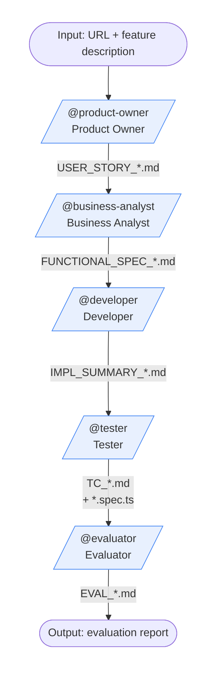

# Multi-Agent Test Generation Pipeline

Dissertation: Lewis Watson, 40619754, Edinburgh Napier University

Sequential dispatch — each agent reads the previous agent's output artefact.

## Stage Summary

| Stage | Agent | SDLC Role | Input | Output |
|---|---|---|---|---|
| 1 | `@product-owner` | Product Owner | Raw requirement (URL + feature description) | `docs/specs/USER_STORY_*.md` |
| 2 | `@business-analyst` | Business Analyst | USER_STORY | `docs/specs/FUNCTIONAL_SPEC_*.md` |
| 3 | `@developer` | Developer | FUNCTIONAL_SPEC (+ live site inspection) | `docs/specs/IMPL_SUMMARY_*.md` |
| 4 | `@tester` | Tester | FUNCTIONAL_SPEC + IMPL_SUMMARY | `docs/test-cases/TC_*.md` + `tests/playwright/*.spec.ts` |
| 5 | `@evaluator` | Evaluator | Playwright test-run results + TC/EVAL artefacts | `docs/evaluation/EVAL_*.md` |
